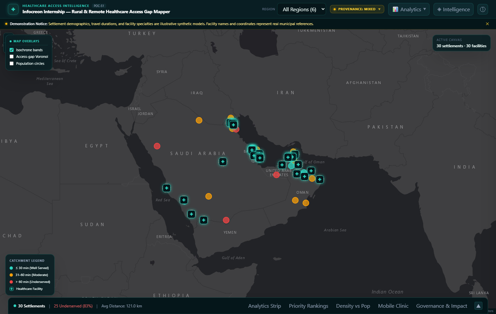
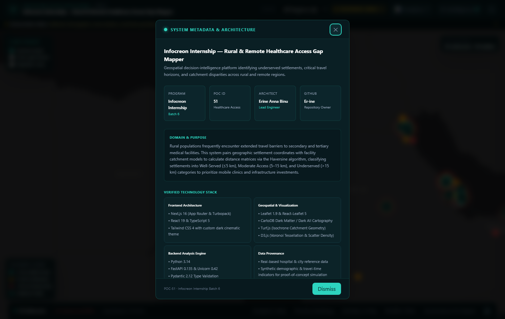
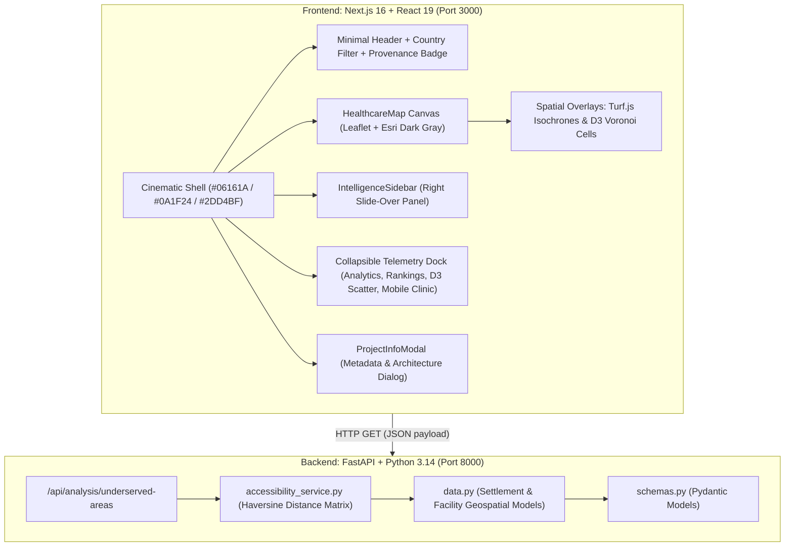

# Rural & Remote Healthcare Access Gap Mapper

[](#project-overview)
[](#project-overview)
[](https://github.com/Er-ine)
[-black.svg)](https://nextjs.org/)
[-009688.svg)](https://fastapi.tiangolo.com/)

An operational geospatial decision-intelligence platform engineered to identify, analyze, and visualize healthcare accessibility disparities facing rural and remote settlements across Gulf Cooperation Council (GCC) nations (Oman, Saudi Arabia, UAE, Qatar, Bahrain, Kuwait).

---

## Visual Preview

| Full-Screen Intelligence Canvas | Settlement Inspection Slide-Over |
| :---: | :---: |
|  |  |
| *Full-viewport map canvas, Esri dark tiles, and bottom telemetry dock* | *Deep-dive settlement accessibility profile, severity score, and travel metrics* |

| System Information Modal | Responsive Mobile View |
| :---: | :---: |
|  |  |
| *Verified system metadata, technical specifications, and architect identity* | *Adaptive layout tested on mobile (390×844) viewport* |

---

## Project Overview

- **Project Title:** Rural & Remote Healthcare Access Gap Mapper
- **Program:** Infocreon Internship — Batch 6
- **POC ID:** 51
- **Architect & Lead Engineer:** Erine Anna Binu ([@Er-ine](https://github.com/Er-ine))
- **Primary Domain:** Healthcare Equity, Spatial Catchment Analytics, Decision Support Systems

Healthcare infrastructure across the Arabian Gulf has historically concentrated in high-density metropolitan and coastal zones. Rural and desert interior settlements often experience significant travel burdens to secondary, tertiary, and emergency care facilities.

This platform bridges this critical intelligence gap by coupling settlement geolocations with healthcare facility coordinates, evaluating distance horizons using the geodesic Haversine model, and generating interactive spatial isochrones, Voronoi access territories, priority ranking matrices, and mobile health clinic dispatch sequences.

---

## Problem Statement

Rural and remote populations face compounding obstacles when accessing essential clinical care:
1. **Critical Travel Horizons**: Settlements situated beyond 15 km (or 30–60 minutes) experience delayed acute emergency care, heightened maternal/perinatal risk, and lower preventive health screening compliance.
2. **Resource Misallocation**: Uniform healthcare resource allocation often overlooks remote clusters with high population density but extreme facility travel distances.
3. **Operational Visibility Gaps**: Healthcare planners require dynamic, spatial tools rather than static spreadsheets to simulate facility catchments, identify isolated populations, and plan mobile clinic routing efficiently.

---

## System Architecture

The application adopts a decoupled, high-performance architecture optimized for geospatial intelligence workflows:



### Key Architectural Layers
1. **Presentation & Cartography Layer**:
   - Next.js 16 with Turbopack and React 19 Client Components.
   - Esri World Dark Gray Canvas tile service: dark, reliable, and free without requiring API keys or exposing credentials.
   - Custom Glowing Medical Pins: Leaflet `divIcon` with teal glowing medical cross emblems (`✚`).
   - Smooth slide-over drawer navigation and keyboard-accessible modal dialogs.
2. **Analytical Layer**:
   - D3.js: Voronoi geometric cell shading representing nearest-neighbor access perimeters; facility density vs. population regression matrix.
   - Turf.js: Geodesic multi-ring spatial isochrone catchment buffers (30 min / 20 km, 60 min / 40 km, 90 min / 60 km).
3. **Calculation & Data Engine**:
   - FastAPI REST service computing pairwise geodesic coordinates using the spherical Haversine formula.
   - Classifies accessibility into **Well Served** (&le;5 km), **Moderate Access** (5–15 km), and **Underserved** (&gt;15 km).
   - Priority severity scoring algorithm integrating travel distance (60% weight) and affected population (40% weight).

---

## Verified Tech Stack

| Layer | Technology | Version | Purpose |
| :--- | :--- | :--- | :--- |
| **Frontend Framework** | Next.js (App Router, Turbopack) | `16.3.2` | Core web application shell & server rendering |
| **UI Runtime** | React & React DOM | `19.2.8` | Component lifecycle & reactive state tree |
| **Styling Engine** | Tailwind CSS & `@tailwindcss/postcss` | `^4.0.0` | Cinematic dark theme tokens & responsive utilities |
| **Mapping Library** | Leaflet | `1.9.4` | Interactive slippy map engine |
| **React Map Binding** | React-Leaflet | `5.0.0` | Declarative map component bindings |
| **Tile Provider** | Esri World Dark Gray Canvas | REST Service | Watermark-free, dark cartographic basemap |
| **Spatial Geometry** | Turf.js (`@turf/turf`) | `7.4.0` | Multi-ring circular catchment isochrones |
| **Data Visualization** | D3.js (`d3`) & `@types/d3` | `7.9.0` | Voronoi tessellation & density scatter plots |
| **Backend Framework** | FastAPI | `0.135.2` | High-performance asynchronous REST API |
| **ASGI Web Server** | Uvicorn (`uvicorn[standard]`) | `0.42.0` | Production ASGI HTTP server |
| **Data Validation** | Pydantic | `2.12.5` | Strict schema validation and data serialization |
| **Language Runtime** | Python | `3.14.4` | Spatial calculations & Haversine distance engine |
| **Language Runtime** | TypeScript | `^5.0.0` | Strict type safety across the frontend |

---

## Installation & Running Locally

### Prerequisites
- **Node.js**: 20.9 or higher; **npm**: 10 or higher
- **Python**: 3.10 or higher
- **Docker-based setup**: Docker Engine/Desktop with Docker Compose

The commands below run from the Phase 2 project checkout. No database, API key,
or credential is required. The Python API and Next.js frontend are separate
services.

### Local development

In a terminal, start the backend (PowerShell on Windows):

```powershell
cd backend
py -m venv .venv
.\.venv\Scripts\Activate.ps1
python -m pip install -r requirements.txt
python -m uvicorn app.main:app --reload --host 127.0.0.1 --port 8000
```

On macOS/Linux, use `python3 -m venv .venv` and
`source .venv/bin/activate` instead of the Windows virtual-environment
commands. Keep the backend running.

In a second terminal, start the frontend:

```powershell
cd frontend
npm ci
npm run dev
```

Open [http://localhost:3000](http://localhost:3000). The browser calls the API
at `http://127.0.0.1:8000` by default. To change that URL for local development,
set `NEXT_PUBLIC_API_URL` before starting the frontend (in PowerShell:
`$env:NEXT_PUBLIC_API_URL="http://127.0.0.1:8000"`). The backend's
`CORS_ORIGINS` variable is a comma-separated allowlist; its default allows the
frontend at `localhost:3000` and `127.0.0.1:3000`.

To run a local production build, use `npm run lint`, `npm run build`, then
`npm run start -- -p 3000` from `frontend/`.

### Docker Compose

From the repository root, optionally create a local environment file from the
safe example and edit it if needed:

```powershell
Copy-Item .env.example .env
```

The example contains local ports, the browser-facing API URL, and allowed
browser origins only; it contains no credentials. Validate the Compose
configuration and build/start both services:

```powershell
docker compose config -q
docker compose up --build
```

Open [http://localhost:3000](http://localhost:3000). The API is available at
[http://localhost:8000/health](http://localhost:8000/health) and
[http://localhost:8000/api/analysis/underserved-areas](http://localhost:8000/api/analysis/underserved-areas).
Compose waits for the backend health check before starting the frontend.

To run in the background, add `-d` to `docker compose up --build`; then stop and
remove the containers with `docker compose down`. Press `Ctrl+C` to stop a
foreground run.

The Compose defaults are `FRONTEND_PORT=3000` and `BACKEND_PORT=8000`. If you
change either port in `.env`, also update `NEXT_PUBLIC_API_URL` to the
browser-reachable backend URL and update `CORS_ORIGINS` to include the chosen
frontend origins. The API URL is embedded in the browser bundle at image build
time, so rebuild after changing it:

```powershell
docker compose up --build
```

### Lint, build, and API checks

From `frontend/`, run `npm run lint` and `npm run build`. The repository does
not currently contain automated frontend or backend test suites. With the
backend running, verify `GET /health` and
`GET /api/analysis/underserved-areas` as described above. Compose users can
check service health with `docker compose ps`.

### Repomix context

`repomix.config.json` is a Phase 2-specific configuration. If the Repomix CLI
is installed, generate its separate context output with
`repomix --config repomix.config.json`. This writes
`repomix-output-phase2.xml`, leaving the existing `repomix-output.xml`
untouched. The configuration excludes dependencies, build outputs, screenshots,
and generated Repomix outputs; the included `.env.example` contains only local
configuration values, never credentials. The generated output is ignored by
Git.

### Troubleshooting

- **Port already in use:** choose unused `FRONTEND_PORT`/`BACKEND_PORT` values
  in `.env`; also update `NEXT_PUBLIC_API_URL` and `CORS_ORIGINS`, then rebuild.
- **Frontend cannot reach the API:** use a URL reachable from the browser, not
  a Compose-only service name such as `backend`; ensure that its port is
  published and its origin is included in `CORS_ORIGINS`.
- **Compose reports a configuration or build error:** run
  `docker compose config` for the resolved configuration and inspect service
  logs with `docker compose logs backend frontend`.
- **Map tiles do not load:** the basemap is a remote Esri tile service and
  requires browser network access; the application does not configure an API
  key for it.

---

## API Documentation

### 1. Health Check
- **Endpoint:** `GET /health`
- **Description:** Verifies service availability.
- **Response (`200 OK`):**
  ```json
  {
    "status": "ok",
    "service": "poc51-healthcare-access-mapper"
  }
  ```

### 2. Spatial Accessibility Analysis
- **Endpoint:** `GET /api/analysis/underserved-areas`
- **Description:** Evaluates all settlements against national healthcare facilities, computing Haversine distance matrices, nearest facilities, and categorization statuses.
- **Response (`200 OK`):**
  ```json
  {
    "total_settlements": 30,
    "total_facilities": 30,
    "underserved_count": 25,
    "underserved_areas": [
      {
        "settlement_id": 6,
        "settlement_name": "Al Ula",
        "country": "Saudi Arabia",
        "population": 32000,
        "nearest_facility": "King Abdulaziz Hospital, Jeddah",
        "distance_km": 583.95,
        "accessibility_status": "Underserved"
      }
    ],
    "all_results": [ ... ]
  }
  ```

---

## Data Provenance & Synthetic Data Transparency

Per Section 9 of the engineering specification, data transparency is strictly enforced:
- **Real-Based Facility Data**: Hospital names and coordinates are based on publicly known healthcare institutions across the Gulf (e.g., Royal Hospital Muscat, Sultan Qaboos Hospital Salalah, King Fahad Medical City Riyadh). Centroids represent city-level approximations.
- **Synthetic Demographic & Operational Data**: Settlement population figures, travel durations, facility capacities (bed counts), and specialized clinic rosters are **synthetic illustrative models** designed to demonstrate the catchment and prioritization algorithms. They do not represent verified census or ministry records.
- **Transparency Controls**:
  - A prominent, dismissible **Demonstration Notice** is displayed below the header.
  - The **Provenance Badge** (`DataStatusBadge`) details exact data boundaries.
  - Metrics in the slide-over panel and tables are clearly flagged with `(Synthetic)` and `(Illustrative)` indicators.

---

## Verification & Testing Summary

The project currently provides these repeatable checks:

| Verification Target | Test Performed | Result | Details |
| :--- | :--- | :--- | :--- |
| **Frontend lint** | `npm run lint` from `frontend/` | Available | ESLint script defined in `frontend/package.json` |
| **Frontend production build** | `npm run build` from `frontend/` | Available | Next.js build script defined in `frontend/package.json` |
| **Backend API smoke checks** | `GET /health`, `GET /api/analysis/underserved-areas` | Manual | No automated backend test suite is checked in |
| **Compose configuration** | `docker compose config -q` | Available | Validates the resolved local Compose configuration |
| **Container runtime checks** | Compose health checks | Available | Health checks cover backend and frontend HTTP availability |

Results depend on running these commands in the current checkout; this table
describes available checks, not a claim that they have passed in every
environment.

---

## Verified Screenshots

Screenshots were captured from the live application running on Edge:
1. [`screenshots/1_fullscreen_map_panel_closed.png`](screenshots/1_fullscreen_map_panel_closed.png): Full-screen map with closed intelligence panel and bottom analytics dock.
2. [`screenshots/2_map_intelligence_panel_open.png`](screenshots/2_map_intelligence_panel_open.png): Slide-over intelligence panel open, inspecting Al Ula (583.95 km gap, Critical Severity).
3. [`screenshots/3_project_information_modal.png`](screenshots/3_project_information_modal.png): Project metadata and architecture modal dialog.
4. [`screenshots/4_mobile_viewport.png`](screenshots/4_mobile_viewport.png): Mobile-optimized interface (390×844) with non-overlapping notice sub-bar.

---

## Future Improvements

1. **Road-Network Isochrones**: Integrate OSRM, OpenRouteService, or GraphHopper to compute route-distance and terrain-adjusted drive times instead of geodesic radius bands.
2. **Constrained Mobile Clinic VRP**: Upgrade the current farthest-first heuristic into a multi-stop Capacitated Vehicle Routing Problem (CVRP) solver accounting for crew rest hours and vehicle range.
3. **Official Census Integration**: Ingest verified national spatial data infrastructure (NSDI) and census datasets when authorized data feeds become accessible.
4. **Offline Spatial Caching**: Implement Service Worker vector tile caching for disconnected field workers in remote desert clinics.

---

## Repository & Branch Reference

- **Phase 2 Repository:** [POC-51 — Rural & Remote Healthcare Access Mapper](https://github.com/Er-ine/POC--51--rural-remote-healthcare-access-mapper--Erine-Anna-Binu-Phase-2)
- **Primary Architect:** Erine Anna Binu ([@Er-ine](https://github.com/Er-ine))
